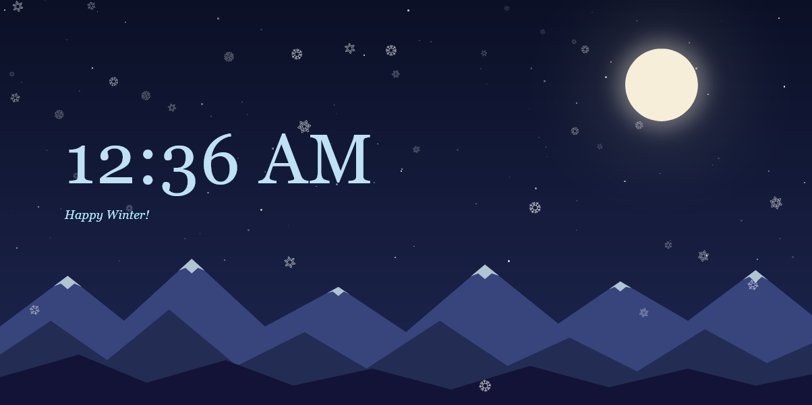

# Winter Night

**[](https://cary1204.github.io/winter-time/)**

Tried to use Vite and npm instead of plain html for this time, cool stuff. Have mountains, sky, moon, and a live clock. Happy Winter!

Will try to remake this with React some times later.

**demo → https://cary1204.github.io/winter-time/**




# Features

 - Unoptimized Code that might lag your browser
 - Time
 - Falling snow
 - Moon phases
 - Planets visible from naked eye
 - Mobile tilt sense (click the screen and press `allow` for the tilt sensor)


# Some stuff used / Credits

Build tool: [Vite](https://vite.dev)

Astronomy Engine: [Astronomy Engine](https://www.npmjs.com/package/astronomy-engine)

npm: [npm](https://www.npmjs.com/)

music: [pixabay no copyright music](https://pixabay.com/)

## Requirements

- Node.js 20 or newer

## How to run

```
npm install
npm run dev
```

Opens the url displayed on the bottom

## Scripts

| Command in json   | Function                                         |
| ----------------- | -------------------------------------------------|
| `npm run dev`     | dev server                                       |
| `npm run build`   | prod in `/disc`                                  |
| `npm run preview` | local prod preview / should look the same as dev |

## Configs

| Settings                                  | Locations                                                           |
| ----------------------------------------- | ------------------------------------------------------------------- |
| Mountains, text, player layout            | `index.html`                                                        |
| Colors, fonts, fade timing, record size   | `src/style.css`                                                     |
| Clock, stars                              | `src/main.js` (`STAR_COUNT`)                                        |
| Snow amount, speed, tilt                  | `src/snow.js` (`FLAKE_COUNT`, `MAX_ANGLE`)                          |
| Moon, planets, spacing                    | `src/sky.js` (`HORIZON`, `MIN_GAP`)                                 |
| Songs                                     | `src/player.js` (`TRACKS` on top), MP3 files go in `public/music/`  |
